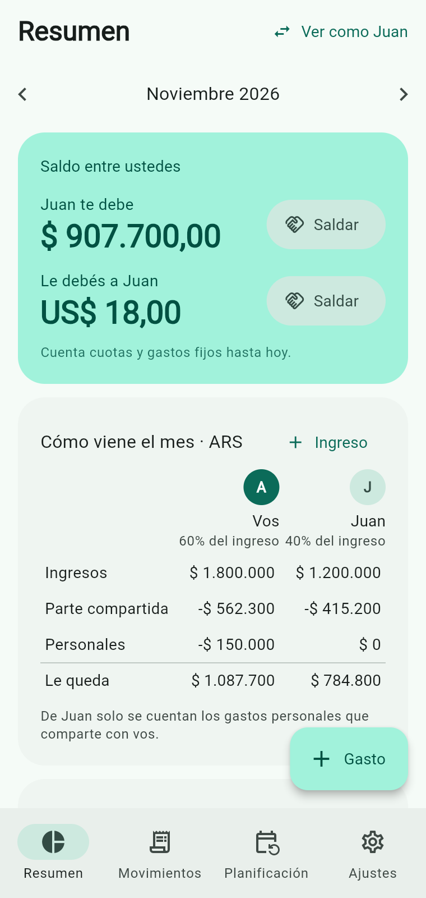
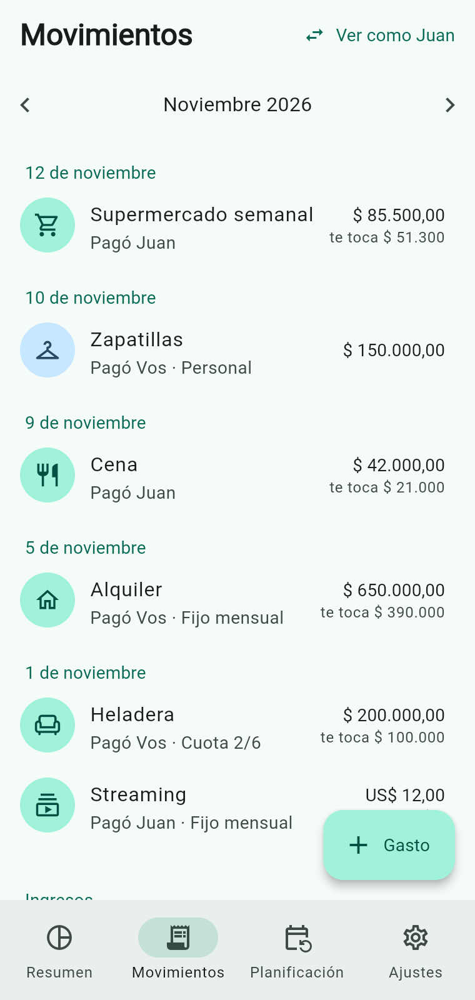
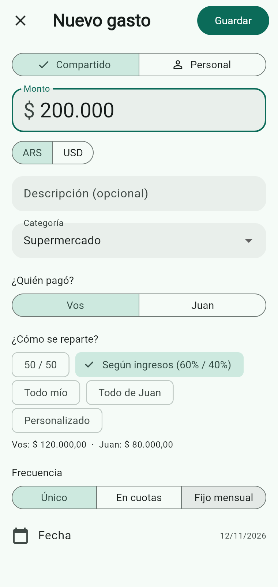
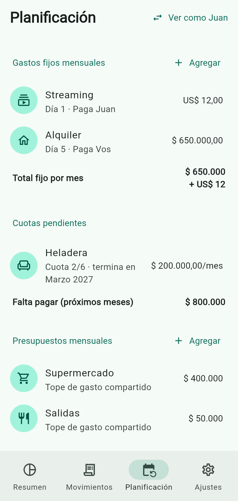
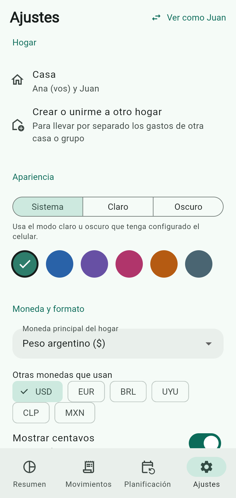
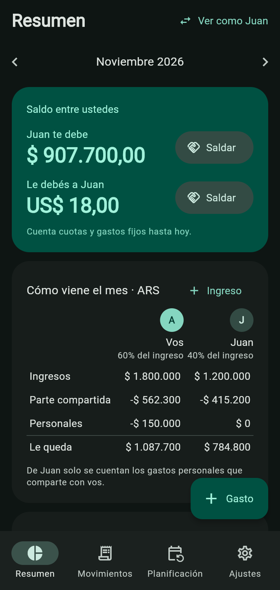

# Gastos en Pareja

App Android (Flutter + Firebase) para llevar el control de gastos en pareja
cuando cada uno tiene un sueldo distinto. Los dos cargan datos desde su celular
y ven todo sincronizado en tiempo real.

| Resumen | Movimientos | Nuevo gasto | Planificación | Ajustes | Modo oscuro |
|---|---|---|---|---|---|
|  |  |  |  |  |  |

## Qué hace

- **Hogar compartido**: uno crea el hogar y la pareja se une con un código de invitación.
  Una misma cuenta puede estar en **varios hogares** y cambiar entre ellos desde Ajustes.
- **Gastos compartidos o personales**. Los personales no afectan el saldo entre ustedes.
- **Reparto elegido en cada gasto**: 50/50, según ingresos del mes (ej. 60/40),
  todo de uno, o un porcentaje personalizado.
- **Saldo "quién le debe a quién"**, separado por moneda, y registro de pagos para saldar.
- **Ingresos** de cada uno por mes, y cuánto **le queda** a cada uno después de sus gastos.
- **Gastos fijos mensuales** (alquiler, servicios, suscripciones) que se repiten solos.
- **Compras en cuotas**: el total se reparte en los meses que corresponden.
  El saldo solo cuenta las cuotas ya vencidas.
- **Monedas configurables por hogar**: una principal y las adicionales que usen
  (ARS, USD, EUR, BRL, UYU, CLP, MXN).
- **Montos con formato mientras se escriben** (`200000` → `200.000`) y centavos opcionales.
- **Presupuesto por categoría** con aviso al 80% y al pasarse.
- **Privacidad configurable por persona**: cada uno elige si su pareja ve todos sus
  gastos personales, ninguno, o si lo decide en cada gasto. Se aplica en el
  servidor (reglas de Firestore), no solo en la app.
- **Apariencia**: tema claro, oscuro o el del celular, y paleta de color a elección.
- **Cambiar de mes deslizando** hacia los costados en Resumen y Movimientos.
- **Borrar datos y empezar de cero**: uno lo pide y el otro lo tiene que aceptar
  (si el hogar tiene una sola persona, es inmediato).

## Probarla sin configurar nada (modo demo)

Si Firebase no está configurado, la app arranca sola en **modo demo** con datos de
ejemplo en memoria. Con el botón "Ver como Juan" se ve la app desde el otro celular.

```bash
flutter run                      # en un emulador o celular Android conectado
flutter run -d chrome            # en el navegador
```

## Configurar Firebase (para usarla de verdad)

1. Crear un proyecto en <https://console.firebase.google.com>.
2. En el proyecto, activar:
   - **Authentication › Sign-in method › Correo electrónico/contraseña**.
   - **Firestore Database** (modo producción).
3. Instalar las herramientas y vincular la app:
   ```bash
   npm install -g firebase-tools
   dart pub global activate flutterfire_cli
   firebase login
   flutterfire configure            # elegir el proyecto y la plataforma Android
   ```
   Esto reemplaza `lib/firebase_options.dart` y agrega `android/app/google-services.json`.
4. Publicar las reglas de seguridad (hay que repetirlo **cada vez que cambia
   `firestore.rules`**; también se puede pegar el archivo en la consola de
   Firebase › Firestore › Reglas):
   ```bash
   firebase use --add               # elegir el proyecto
   firebase deploy --only firestore:rules
   ```
5. Generar el APK e instalarlo en los dos celulares:
   ```bash
   flutter build apk --release
   # queda en build/app/outputs/flutter-apk/app-release.apk
   ```

## Estructura del código

```
lib/
  models/models.dart          Modelo de datos (gastos, ingresos, cuotas, recurrentes…)
  logic/finance.dart          Cálculos: cuotas, saldos, reparto, resumen, presupuestos
  logic/money.dart            Formato y lectura de montos ($ 1.234,56)
  logic/plan.dart             Planes y permisos (base para monetizar más adelante)
  theme.dart                  Tema Material 3 y paletas
  widgets/common.dart         Componentes compartidos
  data/repository.dart        Interfaz de acceso a datos
  data/firestore_repository.dart   Implementación con Firebase
  data/memory_repository.dart      Implementación en memoria (demo y tests)
  app_state.dart              Estado del hogar en vivo para las pantallas
  screens/                    Pantallas
firestore.rules               Reglas de seguridad (acceso por hogar y privacidad)
test/                         Tests de la lógica y de la app en modo demo
```

Los montos se guardan en centavos (enteros) para evitar errores de redondeo.

```bash
flutter analyze && flutter test
```

## Preparado para monetizar (a futuro)

Hoy todo es gratis, pero la base ya está:

- Cada hogar tiene un campo `plan` (`free` / `premium`). Las reglas de Firestore
  **no dejan que la app lo cambie**: solo lo puede escribir un servidor.
- `lib/logic/plan.dart` concentra qué habilita cada plan (`Entitlements`): cantidad
  de hogares, monedas extra, presupuestos, etc. Las pantallas consultan ahí.
- Para cobrar faltaría: publicar en Google Play, integrar compras (Google Play
  Billing o RevenueCat) y una Cloud Function que valide la compra y escriba `plan`.

## Ideas para próximas versiones

- Notificaciones cuando la pareja carga un gasto o se pasa un presupuesto.
- Ajustar el monto de un gasto fijo en un mes puntual (ej. la luz que varía).
- Cotización del dólar para ver totales unificados.
- Metas de ahorro en común.
- Evolución mes a mes y exportar a Excel.
- Categorías personalizadas.
- Adjuntar foto del ticket.
- Colores tomados del fondo de pantalla del celular (Material You).
- Versión iPhone (el código ya es compatible; falta configurar Firebase para iOS).
